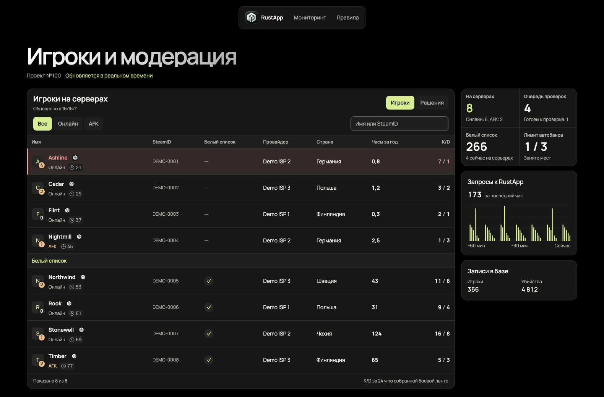
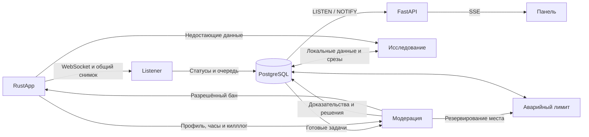
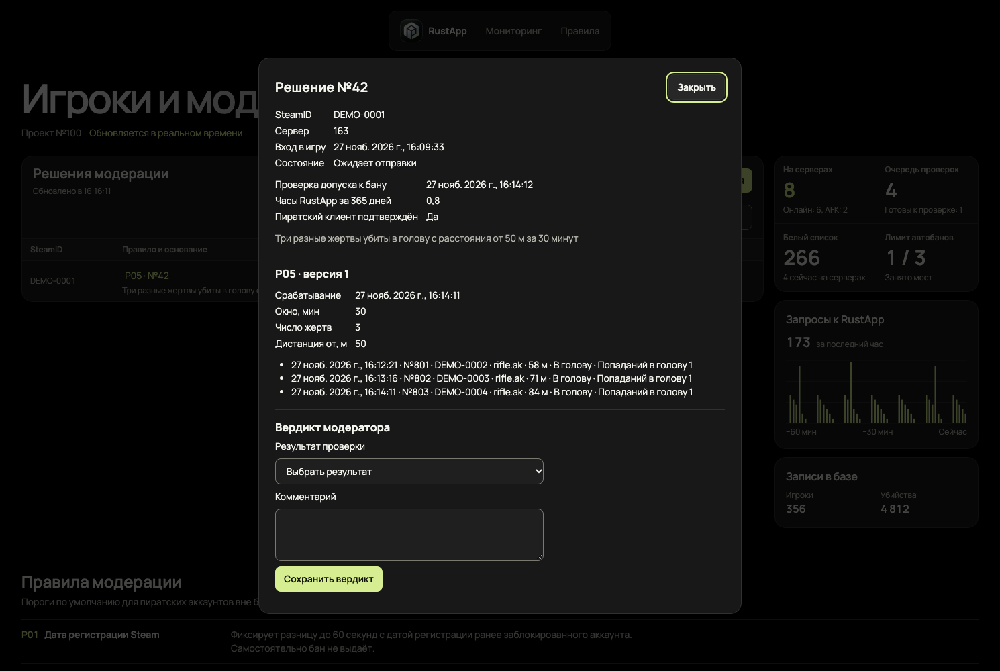
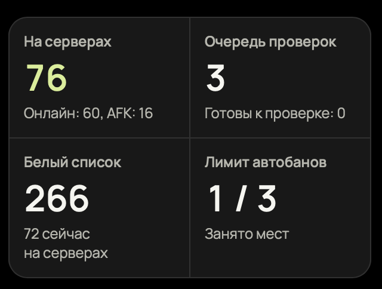
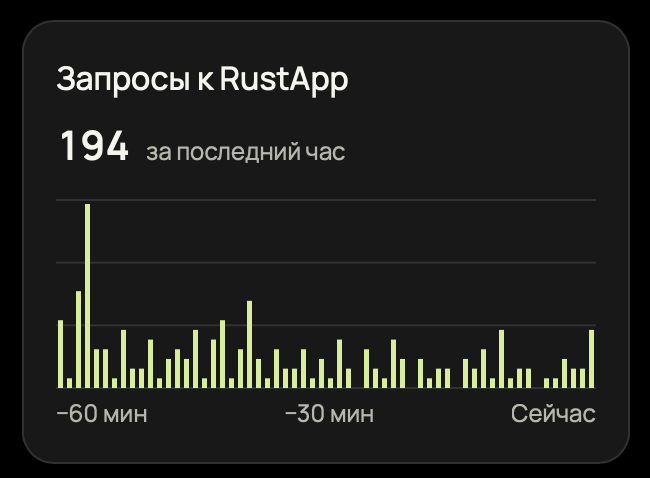

# RustApp Addon

RustApp Addon — панель мониторинга и модерации серверов Rust. Сервис получает данные из RustApp, сохраняет их в PostgreSQL и проверяет игровые события по настраиваемым правилам. В панели видны игроки на серверах, очередь проверок и события, на которых основаны решения модерации.

На сервере наблюдения правила применяются к пиратским аккаунтам вне белого списка, куда входят игроки с подтверждённой лицензией или с **3 часами и более на всех серверах проекта за последние 365 дней**. При включённых автобанах выданная блокировка действует на всех серверах проекта.



*Интерфейс приложения с демонстрационными данными.*

[Запуск](#быстрый-запуск) · [Поток данных](#как-работает-сервис) · [Оптимизация запросов](#как-сервис-снижает-нагрузку-на-rustapp) · [PostgreSQL](#как-организованы-данные-в-postgresql) · [Паттерны](#паттерны-модерации) · [Исследование](#как-собирали-паттерны)

## Быстрый запуск

Понадобятся Docker с Compose v2, доступ к проекту в панели RustApp и токен аккаунта. Команды выполняются из корня репозитория. Проект использует Python 3.12, FastAPI, SQLAlchemy, Alembic и PostgreSQL 17. Веб-панель работает на HTML, CSS и JavaScript.

Создайте каталог `secrets/` и поместите в каждый файл одно значение. Храните файлы с правами только для нужных пользователей. На Linux контейнер приложения должен иметь право чтения своих файлов секретов.

| Файл | Значение |
| --- | --- |
| `secrets/postgres_password` | Пароль администратора PostgreSQL `postgres` |
| `secrets/app_db_password` | Пароль пользователя приложения `rustapp_app` |
| `secrets/app_rustapp_access_token` | Токен аккаунта RustApp |

Для новой базы сначала запустите PostgreSQL и откройте консоль администратора.

```sh
docker compose up -d --wait db
docker compose exec db psql -U postgres -d rustapp_addon
```

В консоли PostgreSQL создайте роль приложения. Команда `\password` запросит значение из `secrets/app_db_password` интерактивно.

```sql
CREATE ROLE rustapp_app LOGIN;
\password rustapp_app
ALTER DATABASE rustapp_addon OWNER TO rustapp_app;
\q
```

При наличии настроенной базы с этой ролью переходите к миграциям и запуску.

```sh
docker compose --profile tools build api moderation
docker compose --profile tools run --rm migrate
docker compose --profile tools up -d --wait api listener moderation research
```

Панель доступна на [127.0.0.1:8000](http://127.0.0.1:8000/). По умолчанию используется режим наблюдения. Для отправки банов задайте `APP_MODERATION_ENFORCE=true` в локальном `.env` и пересоздайте обработчик.

```sh
docker compose --profile tools up -d --no-deps --force-recreate moderation
```

| Настройка | По умолчанию | Назначение |
| --- | --- | --- |
| `APP_MODERATION_ENFORCE` | `false` | Разрешает отправку автобанов |
| `APP_MODERATION_SERVER_ID` | `163` | Сервер для оценки поведения |
| `APP_MODERATION_POLL_SECONDS` | `150` | Интервал плановой проверки активного игрока |
| `APP_MODERATION_REQUEST_INTERVAL` | `1` | Минимальная пауза между HTTP-запросами обработчика, в секундах |
| `APP_MODERATION_INITIAL_BAN_PAGES` | `1` | Глубина первого заполнения локального каталога банов |
| `APP_MODERATION_PATTERNS` | Пороги из таблицы ниже | Настройки отдельных правил в JSON |

Для другого проекта передайте одинаковый `APP_RUSTAPP_PROJECT_ID` через окружение сервисов `api`, `listener`, `moderation` и `research` в конфигурации Compose. В текущей конфигурации Python использует проект `9867`. Файлы `.env`, `secrets/` и локальные исследовательские выгрузки исключены из Git. [Конфигурация Compose](compose.yaml) · [Настройки приложения](backend/app/core/config.py)

## Как работает сервис



1. **Слушатель восстанавливает список игроков.** При запуске WebSocket даёт изменения статусов, а общий HTTP-снимок добавляет сервер, тип клиента и поля для панели. Вход, выход и переходы AFK обновляют одну запись присутствия. Точное время входа используется только при наличии подтверждающего события.
2. **Очередь выделяет тех, кого нужно проверить.** Первую проверку получают активные игроки вне белого списка. Новые входы и возвраты из AFK имеют приоритет над плановыми повторами. После выхода игрок снимается с очереди, а при AFK персональные проверки модерации приостанавливаются.
3. **Обработчик сначала проверяет право на белый список.** На первом проходе за текущий вход он получает годовой `/stats` по всем серверам проекта. Уже сохранённые завершённые дни RustApp также могут доказать порог. При подтверждённых 3 часах или лицензии глубокая проверка завершается. Часы приходят от RustApp, а события WebSocket помогают установить время входа для паттернов.
4. **Детектор оценивает события по времени убийства.** После получения страницы киллога сервис сохраняет события, проверяет правила и записывает совпадения с порогами, версией и доказательствами. Окно в 30 минут ограничивает разброс событий. Если нужная серия появилась за две минуты, правило может сработать уже при следующем чтении киллога.
5. **Отправка проходит отдельную проверку.** В режиме автобанов сервис ещё раз сверяет текущую сессию, статус, лицензию, сервер, IP, белый список и свежие годовые часы. Для отправки требуется подтверждённое время строго меньше 3 часов. Неясный ответ по часам блокирует отправку. После допуска аварийный сервис выделяет место, а результат сверяется с RustApp.

Панель показывает список онлайн и AFK, белый список, репорты, K/D по сохранённым событиям за сутки, часы и давность проверки. На вкладке «Решения» открываются доказательства и форма вердикта модератора. При изменениях в PostgreSQL браузер получает обновления по SSE.



*Карточка решения на демонстрационных данных.*

## Как сервис снижает нагрузку на RustApp

| Решение | Зачем и как работает |
| --- | --- |
| **WebSocket и групповой снимок** | События присутствия приходят потоком. Один HTTP-снимок восстанавливает состав и профили игроков на старте или после разрыва связи. Минимальная пауза между снимками составляет минуту. |
| **Белый список и статусы** | Белый список отсекает персональные запросы модерации. Проверка статуса перед HTTP помогает не тратить запрос на игрока, который успел выйти или перейти в AFK. У исследовательского сбора отдельная политика допуска. |
| **Одна задача на игрока** | Ключ «проект + SteamID» объединяет входы и плановые повторы в PostgreSQL. Обработчик берёт готовую задачу с блокировкой строки `FOR UPDATE SKIP LOCKED`. Плановый повтор доступен через 150 секунд, фактический старт зависит от очереди. |
| **Кэши с разными сроками** | Профиль, число проверок и IP переиспользуются в течение 10 минут. Репорты могут обновляться раз в 10 минут в активной сессии. Обычный повтор в основном читает килллог. Истории ников, команд и сессий в текущем сборе не запрашиваются. |
| **Короткие страницы** | Для каждого прохода боевой ленты берётся первая страница до 25 событий, включая смерти. Новые страницы дополняют локальные события, а границы и непрерывность покрытия сохраняются отдельно. P07 требует подтверждённого покрытия своего окна. |
| **Повтор часов по необходимости** | Если у игрока 2,5 часа, повторный запрос возможен примерно через 30 минут. Минимальная пауза составляет 10 минут, при неполных данных или некоторых ошибках используется более редкий повтор. Перед отправкой бана требуется отдельная свежая проверка. |
| **Сверка банов по известной границе** | Общий `/ban/browse` запускается при старте и каждые 5 минут. Пагинация заканчивается на уже известной записи либо на конце списка. Сверка отправленных решений начинается с локальной базы. Для исходного бана P02 или P04 возможен точечный запрос. |
| **Отдельный бюджет исследования** | Сначала переиспользуются накопленные ответы и завершённые дни. Фоновое чтение заполняет пробелы с интервалом от 180 секунд и бюджетом до 120 попыток за скользящие сутки на аккаунт. Если очередь онлайн-проверок отстаёт более чем на 30 секунд, исследование уступает ей. |
| **Общая пауза при HTTP 429** | В PostgreSQL сохраняется пауза для аккаунта по `Retry-After`, по умолчанию 60 секунд. Счётчик обращений учитывает попытки и хранит время без тела запроса. |

<table>
  <tr>
    <td></td>
    <td></td>
  </tr>
</table>

*Снимки счётчиков из работающего приложения. Число запросов отражает один час наблюдения и зависит от онлайна, состава игроков и активности фоновой очереди.*

[Сбор данных игрока](backend/app/services/moderation/collect.py) · [Учёт запросов](backend/app/crud/rustapp_requests.py) · [Сверка банов](backend/app/services/moderation/bans.py)

## Как организованы данные в PostgreSQL

| Что хранится | Таблицы и представления | Зачем |
| --- | --- | --- |
| Игрок и текущее присутствие | `players`, `rustapp_player_presence`, `collection_jobs` | Лицензия, белый список, статус, текущая сессия и расписание проверки. Состояние очереди переживает перезапуск. |
| Ответы RustApp | `rustapp_player_data`, `rustapp_observations` | Последний ответ по каждому разделу доступен для быстрых чтений. Изменившиеся ответы сохраняются с временем наблюдения и, когда известны, параметрами запроса. |
| События и связанная информация | `combat_kills`, `combat_deaths`, `rustapp_player_ips`, `rustapp_player_reports` | Частые запросы по событиям используют отдельные записи. Повторное получение того же ID обновляет запись, сохраняя один экземпляр события или репорта. |
| Часы проекта | `player_playtime`, `rustapp_playtime_days` | Проверенный годовой итог хранится вместе с датой запроса. Завершённые дни UTC можно переиспользовать при проверке белого списка и дозапрашивать только недостающие интервалы. Частичное покрытие даёт нижнюю границу часов. |
| Баны и решения | `rustapp_bans`, `moderation_decisions` | Каталог банов RustApp и журнал собственных решений хранятся отдельно. Решение привязано к сессии и содержит доказательства, вердикт и состояние отправки. |
| Исследовательские срезы | `research_cases`, `research_case_sources`, `research_dataset` | У каждого среза есть группа, дата отсечения и версии. У каждого источника есть параметры, происхождение и полнота покрытия. |
| Запросы и паузы | `rustapp_requests`, `rustapp_request_gate` | График нагрузки, общий лимит исследования и пауза после ограничения RustApp. |

Свежие данные хранятся рядом с историей, потому что панель и анализ читают их по-разному. Для панели нужен последний профиль и агрегированные события, для исследования важно знать, когда именно наблюдался каждый ответ. PostgreSQL обновляет связанные записи в транзакциях. Уникальные ключи и `INSERT ... ON CONFLICT` позволяют повторять сбор без размножения строк. Узкие индексы поддерживают выборки очереди, поиск боевых событий и график обращений.

Аварийный сервис сериализует выделение места для бана блокировкой PostgreSQL. Всего доступно три места на проект. Уже выданные баны и отправки с неизвестным результатом занимают места. При потере ответа приложение ищет запись по маркеру решения в RustApp, чтобы сначала выяснить результат отправки. Если панель однозначно отказала, место освобождается.

[Модели и ключи](backend/app/models) · [Миграции](backend/migrations/versions) · [Аварийный лимит](backend/app/ban_guard/quota.py) · [Обновления панели](backend/app/services/dashboard/updates.py)

## Паттерны модерации

Пороги ниже относятся к настройкам по умолчанию. P01 фиксирует совпадение, а P02 использует его в связке с недавним баном. У остальных паттернов отдельные основания и доказательства. Если совпало несколько правил, они сохраняются в карточке, а отправка использует одно основание по приоритету.

| Код | Условие |
| --- | --- |
| **P01** | Дата регистрации Steam отличается не более чем на 60 секунд от даты ранее заблокированного аккаунта. Правило фиксирует совпадение для связки P01/P02. |
| **P02** | Есть совпадение P01 с тем же исходным баном, выданным не более чем за час до подключения новичка. Для автобана у обоих правил должно стоять действие `ban`. |
| **P03** | Закрытый профиль Steam без даты регистрации и три разные жертвы в первые 10 минут первой подтверждённой игровой сессии. |
| **P04** | Новичок с закрытым профилем без даты Steam подключился в течение 15 минут после бана другого пиратского аккаунта на том же сервере. Требуется наблюдавшееся событие подключения. |
| **P05** | Три разные жертвы убиты в голову с дистанции от 50 м в одном 30-минутном окне. |
| **P06** | Три разные жертвы убиты в голову в одном 30-минутном окне. Для каждой зафиксировано не менее двух попаданий с уроном от стрелка, все в голову. |
| **P07** | Минимум пять убийств с дистанции от 20 м за 30 минут, не менее 80% в голову. Требуется подтверждённая полнота ленты за окно. При известном времени входа окно может начаться с момента входа. |
| **P09** | Три разные жертвы в одном 30-минутном окне в первый час после создания профиля на проекте. |

P05–P07 используют выбранные классы оружия. Настройки передаются в `APP_MODERATION_PATTERNS`. Для каждого правила доступны `off`, `observe`, `review` и `ban`. Например, P05 можно повысить до 70 м и отправлять совпадения на ручную проверку.

```dotenv
APP_MODERATION_PATTERNS='{"P05":{"meters":70,"version":2,"action":"review"}}'
```

[Реализация правил](backend/app/services/moderation/patterns) · [Пороги и типы](backend/app/services/moderation/facts.py) · [Приоритеты и основания](backend/app/services/moderation/evaluate.py)

## Как собирали паттерны

1. **Собрали пилот на сервере №163.** Выгрузили 100 последних записей с причиной «чит» и снимок игроков онлайн. Для каждого аккаунта сохранили доступные профиль, число проверок, статистику, IP, репорты и первую страницу киллога. Историческая выгрузка содержала также данные сессий, по которым можно было проверить сервер и тип клиента.
2. **Привели случаи к сопоставимому виду.** Повторные баны одного аккаунта свели к одной записи. После проверки ближайшей предшествующей сессии в группе банов осталось 97 пиратских аккаунтов, в онлайн-сравнении было 21. В анализ входили события нужного сервера строго до бана или момента снимка. Для правил на разных жертв повторное убийство одного игрока учитывалось один раз.
3. **Сравнили кандидатов.** Проверили дальние хедшоты, последовательности попаданий только в голову, долю хедшотов, темп убийств и комбинации с репортами. Отдельно посмотрели первые минуты игры, совпадения регистрации Steam и близкие по времени входы после бана. Например, условия будущих P05 или P06 нашлись у 24 из 97 заблокированных и у 0 из 21 онлайн-аккаунта.
4. **Перенесли выбранные условия в отдельные модули.** В карточке сохраняются пороги конкретного срабатывания, время и исходные события. Вердикт модератора добавляет обратную связь, а новые данные пополняют две исследовательские группы.

Снимок онлайн включал игроков без известного бана на момент отбора. Для оценки ложных срабатываний нужна отдельная проверка на сопоставимых игровых окнах. Первая страница киллога могла пропустить более ранние события, особенно начало игры у опытных участников. Результаты пилота описывают этот архив и сервер, поэтому показатели охвата зависят от периода и доступности истории.

Текущий фоновый сбор отбирает подтверждённые случаи бана за чит и контрольные аккаунты с **более чем 20 часами по проекту за 365 дней** без известного действующего бана за чит. Для собственных автобанов в группу подтверждённых случаев нужен вердикт модератора. У срезов сохраняются верхняя граница времени и покрытие каждого источника, чтобы при анализе можно было брать только доступные на нужный момент данные. Исторические выгрузки с данными игроков остаются локальными. [Формирование выборок](backend/app/services/research/cases.py) · [Операционное руководство](backend/MODERATION.md#исследовательский-сбор)

## Проверка и эксплуатация

```sh
docker compose logs -f listener moderation research ban-guard
```

Для отладки задайте `APP_LOG_LEVEL=DEBUG` и пересоздайте нужный сервис. В журнале можно сопоставить обращения к RustApp, переходы задачи, действия PostgreSQL и этапы отправки решения. Подробнее о состояниях решения, повторной сверке и проверке срезов написано в [руководстве по модерации](backend/MODERATION.md).

Из каталога `backend` можно запустить локальные проверки.

```sh
uv sync --locked
uv run ruff check .
uv run pytest
```

Для интеграционных тестов задайте `MODERATION_TEST_DB_URL` на отдельную тестовую PostgreSQL и предварительно примените к ней миграции. Без этого адреса pytest запускает тесты, которым база не требуется. [Тесты](backend/tests) · [Настройки инструментов](backend/pyproject.toml)
